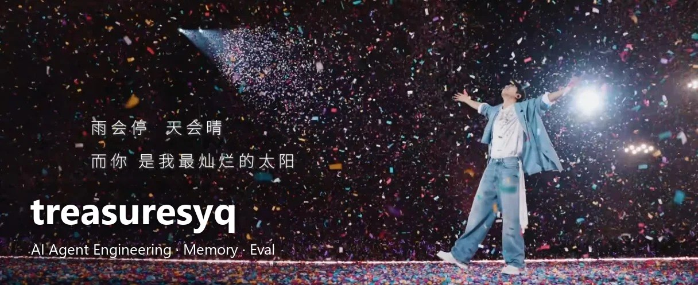
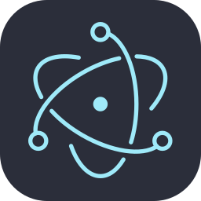

  

  

  
  

## 👋 关于我

你好，我是 **treasuresyq**，跟随前沿信息：[AI HOT](https://aihot.news/) ，正在邪修成为一名 AI领域中的 **Builder 和 Seller** 的结合体。

我关注 **Agent Memory、评测与自进化 Agent**：记忆如何可靠写入、召回和更新，失败如何通过 Trace / Eval 复现，反馈如何证明下一轮行动确实更好。我在个人项目和已合并的上游 PR 中实践记忆召回、离线评测与执行可靠性，也持续跟进 RSI 的研究进展。在项目[AI Native CRM](https://github.com/treasuresyq/Pi---AiNativeCrm) 与 [研迹 · ResearchTrail](https://github.com/treasuresyq/Trail) 中，我已接入并探索双 Harness 架构，通过比较不同执行路径，为后续研究基于评测反馈的递归自我改进做准备。近期，我也在研究 **CMA-ES 与离散组合搜索**，探索如何生成候选策略、利用评测反馈调整搜索，并验证每轮改进是否有效。 &#x20;

我也探索 **AI 数字人**的交互与记忆表达，并将金融研究兴趣落实在本地 AI 投资研究工作台「研迹」。欢迎通过 [邮箱](mailto:2539490080@qq.com) 交流。 &#x20;

🌱 我也持续参与开源协作，在 Agent 工程实践中打磨可靠性与工具链。

## 🛠️ 技术与创作工具

  
  

  
  
  
  
  

## 项目实践

- **[Miniclaw · 多数字员工工作台](https://github.com/treasuresyq/miniclaw)** — 自托管、Pi Agent 驱动的多渠道智能体工作台，将 Agent、Workspace、持久化记忆、Skills、MCP、Subagents、任务调度与运行历史组织在同一个可控环境中。
- **[AI Native CRM · Agent 原生 CRM](https://github.com/treasuresyq/Pi---AiNativeCrm)** — 以真实 CRM 为状态空间的 Agent 工作台，让 Agent 在权限边界内读取客户、商机、知识与记忆，并通过受控工具推进业务，保留审批、执行记录与可追溯证据。
- **[研迹 · ResearchTrail](https://github.com/treasuresyq/Trail)** — 本地优先的 AI 投资研究桌面工作台，连接行情、K 线与 Agent 深度研究，把来源、证据、投资逻辑与持续复核放在同一工作区。
- **[VisaFlow · 签证审查应用](https://github.com/treasuresyq/VisaFlow)** — 面向签证材料审查与办理流程的桌面应用，将案件与材料版本、规则核验、证据追溯、模型复核和人工审批串成完整流程。
- **[AI Digital Human](https://github.com/treasuresyq/cyber-girlfriend-16gb)** — 支持自定义角色的逐轮语音数字人原型，串联语音识别、DeepSeek 对话、语音合成与本地 LivePortrait / MuseTalk 口型和表情视频生成。
